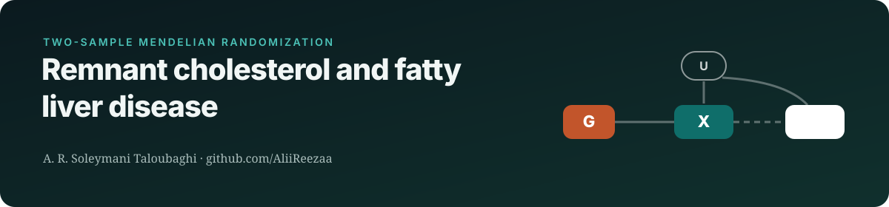
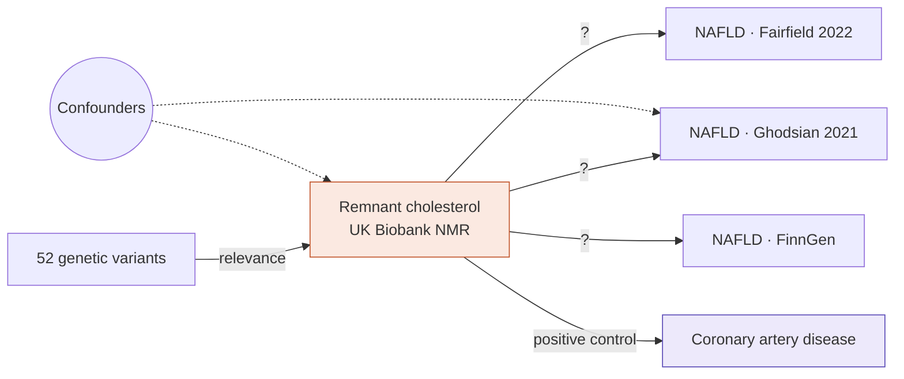

    

> **Status:** manuscript complete; under preparation for submission
>
> This repository is a public overview of an unpublished study. It shows the research question, design and methods. **Results, data and analysis code are withheld until peer-reviewed publication**, and will be released here at that point.

## Research question
Remnant cholesterol (cholesterol carried in triglyceride-rich lipoproteins) is a causal risk factor for coronary disease. **Does it also cause non-alcoholic fatty liver disease (NAFLD)?**

## Study design

## Data sources
| Role | Dataset | Notes |
|---|---|---|
| Exposure | Richardson et al. 2022, UK Biobank NMR (GWAS Catalog) | 52 instruments |
| Outcomes | Ghodsian 2021 · Fairfield 2022 · FinnGen | three independent NAFLD GWAS |
| Positive control | CARDIoGRAMplusC4D coronary artery disease | validates the instruments |

## Methods
| Component | Approach |
|---|---|
| Primary | IVW after MR-PRESSO outlier removal |
| Sensitivity | MR-Egger, weighted median/mode, MR-RAPS, MR-Lasso, radial MR, Steiger, leave-one-out |
| Pleiotropy checks | analyses excluding APOE and hepatic loci (TM6SF2, GCKR, TRIB1) |
| Genetic correlation | LD score regression |
| Power | a priori power analysis for each outcome |

## Why it matters
Lipid-lowering therapies that target remnant cholesterol are in development. Knowing whether they would also help fatty liver disease affects trial design.

## Team & role
Analyst and co-author **A. R. Soleymani Taloubaghi**, with M. Akbarzadeh and D. Habibi (corresponding).

## Reproducibility
- Analysis pipeline written in Python (pipeline) and R (TwoSampleMR, MendelianRandomization, mr.raps, RadialMR, MRPRESSO), LDSC, with pinned package versions and a single entry-point script
- Public summary statistics only; no individual-level data is used or shared
- Reported according to STROBE-MR

---
Contact: <a href="mailto:alirezasoleymani24@gmail.com">alirezasoleymani24@gmail.com</a> · <a href="https://aliireezaa.github.io">aliireezaa.github.io</a>
